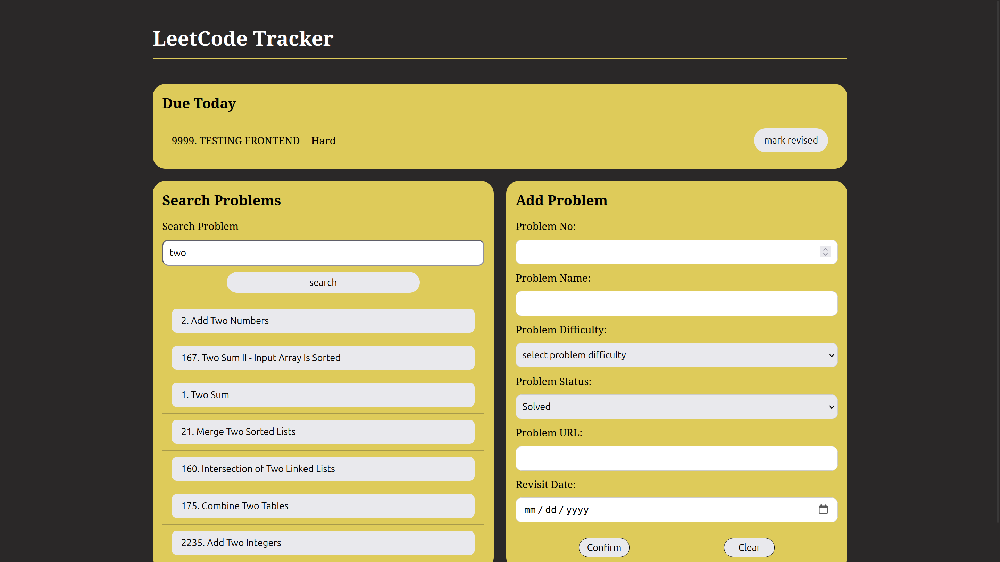
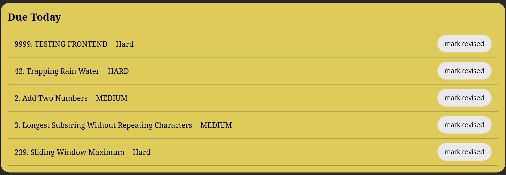
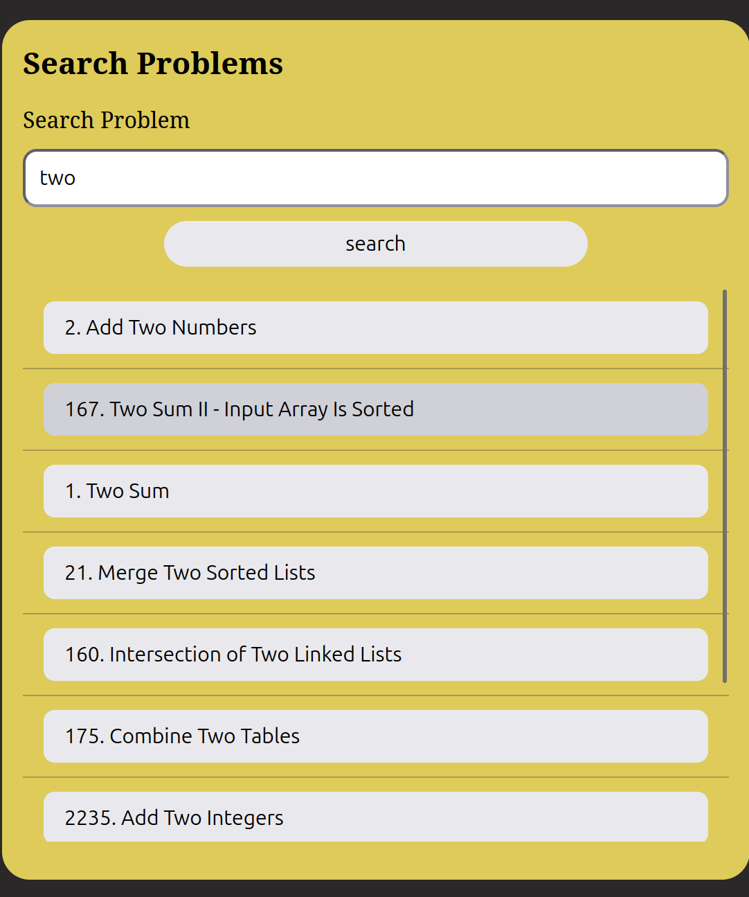
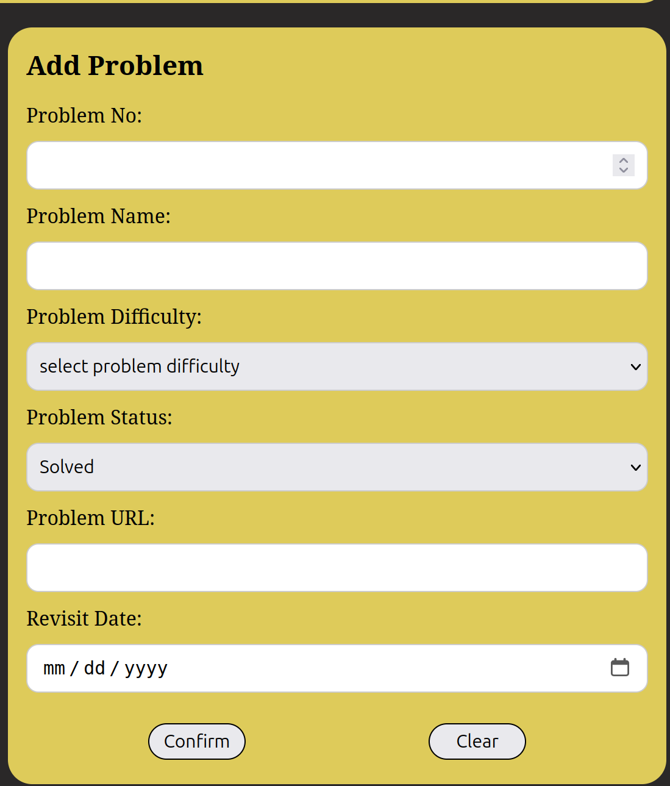

# LeetCode Tracker - self mini project

## What is this project about
* A mini dashboard project to help *me* track my solved leetcode problems effeciently 
* Started this project to **fulfill** what i *needed* that is helping me in revisiting already solved problems 

## Screenshots

### Full dashboard:

### Due today section:

### Search problems section:

### Add problems section:


## Features
* single page dashboard view
* show daily due problems to revisit and unsolved due problems get stacked 
* when a problem is revisited, allows user to set the new revisit date or just remove the problem from revisit cycle
* the titles are clickable links connected to their respective leetcode problems making it easier to go to the problems easily
* allow users to search for the solved problems from the database
* if problem number is typed will give the exact problem and if name or similar like string is typed, will give the matching results
* clicking on the search result's problems open a dialog to change their revisit date or remove from cycle
* can add solved problems in the database from the dashboard reducing the work of writing sql everytime to add a problem

## Tech Stack
**Backend:** Python with flask, no big reason heard its beginner friendly  
**Database:** PostgreSQL for storing the problems in a database  
**Front-end:** HTML, CSS and vanilla JavaScript

## How to run

### 1. Prerequisites
* Python
* PostgreSQL
* Git


### 2. Clone the repository

#### bash command to use
```bash
git clone https://github.com/KishanthB/leetcode-tracker.git
```

#### change your directory to the project directory
```bash
cd leetcode-tracker
```

### 3. Create virtual environment

To isolate the project specific dependencies from the system wide dependencies, create a virtual environment inside the folder *leetcode-tracker*

#### command to use in terminal
```bash
python3 -m venv .venv
```

#### activate the virtual environment
```bash
source .venv/bin/activate
```

### 4. Install dependencies
Install the required packages for python using the requirements.txt file
```bash
pip install -r requirements.txt
```

### 5. Set up the database
Next create the database which will store the problems and tags by following the sql commands used in this file [schema.sql](schema.sql)

### 6. Set environment variables
* Create the .env file in the root directory of the project
* inside the .env file create environment variables like this  

**Example values, use the values that match your exact database configuration** 
```env
DB_NAME=*your_database_name*
DB_USER=*your database_user_name*
DB_PASSWORD=*your_database_password*
DB_HOST=localhost
DB_PORT=5432
```

### 7. Start the application
finally start the application by using the following command 
```bash
#not needed if venv is already activated
source .venv/bin/activate

python3 app.py
```

*to see the application go to this url in your browser [click here](http://localhost:5000)*

## Flask REST API endpoints
| **Method** | **Endpoint** | **Purpose** |  
|------------|--------------|-------------|
| GET        | `/api/problems` | 	Retrieve all problems |
| GET        | `/api/problems/due` | Retrieve problems due for revision |
| GET        | `/api/problems/search` | Search for solved problems |
| POST       | `/api/problems` | Add a problem |
| PATCH      | `/api/problems/<problem_no>` | update a problem's revision information |

## Limitations
* No user authentication; currently intended for personal use
* Problem must be added manually 
* No automatic synchronization with LeetCode
* No Delete button or API endpoint to remove a problem from DB
* Tags of a problem are not visible currently

## Future Improvements
* Import previously solved problems in bulk
* Add custom problem lists
* Improve revision scheduling
* Add user authentication
* An API endpoint to delete the problems
* visualizations such as daily streak, heatmaps
* allowing users to have multiple submission history with its specific notes and time taken to solve
* showing the topics taking long to solve in the homepage
* AND MANY MORE IF POSSIBLE